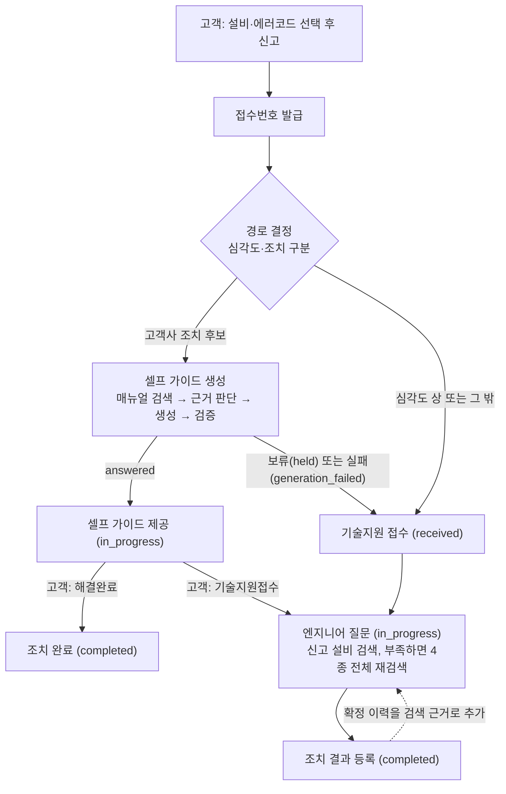

<!--
  [올리기 전에 확인할 곳] (이 블록은 화면에 보이지 않습니다)
  1. 이 README의 기능·범위·규칙은 docs/spec.md, 실행 방법은 docs/RUN.md 기준입니다. 두 문서가 바뀌면 같이 고쳐 주세요.
  2. 슬로건("설비가 멈춘 순간, 근거 있는 첫 대응")은 제안입니다. images/*.svg를 바꾸면 이미지 문구도 바뀝니다.
-->

<p align="center">
  
</p>

<p align="center">
  
</p>

<p align="center">
  
  
  
  
  <a href="https://github.com/movebrain/m-pilot/actions"></a>
</p>

> 이 저장소의 모든 데이터(매뉴얼, 에러코드, 서비스 이력)는 **가상**입니다. 앱의 모든 화면에도 “모든 데이터는 가상”이 표시됩니다.


## 설비 장애 대응 지원, 근거 있는 첫 대응

설비가 멈추면 현장은 "무엇부터 해야 하지?"에서 시간을 씁니다. **M-Pilot**은 고객이 **설비와 에러코드를 골라 신고**하면 에러코드 표의 심각도와 조치 구분으로 경로를 나눕니다. 고객이 직접 조치할 수 있는 고장은 **셀프 가이드**를 받고, 위험하거나 고객이 조치할 수 없는 고장은 **엔지니어에게 접수**됩니다. 엔지니어에게는 **같은 설비의 매뉴얼과 확정된 과거 조치**에 근거한 답을 단계마다 출처와 함께 보여 줍니다. 근거를 찾지 못하면 지어내지 않고 **조치 없이 그 사실만 알립니다.**


| 이름 | 파트 | GitHub |
|:---:|:---:|:---:|
| 노동균 | UI·총괄 | [@rohdonggyun-lab](https://github.com/rohdonggyun-lab) |
| 김성일 | DB | [@tjddlf112015-jpg](https://github.com/tjddlf112015-jpg) |
| 손재호 | DB | [@thswogh](https://github.com/thswogh) |
| 이재서 | DB | [@8113jsl-ui](https://github.com/8113jsl-ui) |
| 도예진 | RAG | [@yejjini](https://github.com/yejjini) |
| 정혜윤 | RAG | [@hyey00n](https://github.com/hyey00n) |
| 한시온 | RAG | [@zionhann](https://github.com/zionhann) |

| 파트 | 맡은 일 | 담당 폴더 |
|---|---|---|
| **UI·총괄** | 고객·엔지니어 화면, 앱 조립·실행, 화면과 DB·RAG를 잇는 서비스 함수 | `app.py` `app_customer.py` `app_engineer.py` `mpilot/ui/` `mpilot/service.py` `fake/` |
| **DB** | 매뉴얼 PDF 파싱·청킹, 초기 자료 적재, 신고·대화·조치 저장·조회, 검색 색인 | `mpilot/db/` `scripts/init_db.py` `scripts/build_error_codes.py` `scripts/build_history_seed.py` |
| **RAG** | 근거 검색, 답변 생성·인용 검증, 고객 안내·엔지니어 답변 흐름, 품질 평가 (도예진: `pipeline`, 정혜윤: `generator`) | `mpilot/rag/` `prompts/` `scripts/evaluate.py` |


## 근거가 있을 때만 답합니다

현장에서 필요한 건 그럴듯한 문장이 아니라 **믿고 따라 할 수 있는 조치**입니다. 그래서 모든 답변은 매뉴얼의 쪽·절, 확정된 이력 같은 **출처에 연결**되어야 하고, 출처가 근거와 다른 답은 보여 주지 않습니다. 고객이 위험한 조치를 하지 않도록, 고객 안내는 **고객사 조치로 분류된 코드의 매뉴얼 근거만** 사용합니다.

고객 앱(포트 7860)과 엔지니어 앱(포트 7861)은 **서로 분리된 두 개의 앱**입니다.

| 영역 | 기능 | 내용 |
|---|---|---|
| 고객 | 신고 작성 | 설비와 에러코드를 고르고 제출하면 접수번호가 발급됩니다. 심각도가 높거나 고객이 조치할 수 없는 고장은 엔지니어에게 접수되고, 나머지는 셀프 가이드를 받습니다. |
| 고객 | 신고 목록·상세 | 내가 접수한 신고를 최신순·상태별로 봅니다. 셀프 가이드 건은 단계별 안내와 출처를, 엔지니어 처리 건은 완료 뒤 조치 결과를 봅니다. 내부 분석은 보이지 않습니다. |
| 엔지니어 | 대시보드 | 기존 서비스 이력과 신규 신고를 상태별로 보고, 기술지원 건을 누르면 대화창으로 이동합니다. 셀프 가이드 건은 ‘고객 안내’로만 표시됩니다. |
| 엔지니어 | 장애 분석 대화 | 신고 건에서 질문하면 신고한 에러코드를 기준으로, 같은 설비의 매뉴얼·과거 이력에서 찾은 근거로 출처가 붙은 답을 줍니다. 신고 설비 자료로 근거가 부족하면 4종 전체에서 한 번 더 찾고, 그때는 다른 설비 자료가 섞였다는 안내를 함께 보여 줍니다. 첫 질문에 ‘조치 중’이 됩니다. |
| 엔지니어 | 이력 저장 | 원인·실제 조치·결과를 입력해 완료하면 ‘조치 완료’가 되고, 확정된 조치는 다음 질문의 근거가 됩니다. |
| 공통 | 가상 데이터 고지 | 모든 화면에 “모든 데이터는 가상”이 보이고, 오류는 고정 문구로만 안내합니다. |

### 경로 결정과 상태

에러코드 표의 **심각도와 조치 구분만** 써서 셀프 가이드 후보를 정합니다.

| 순서 | 조건 | 경로 |
|:---:|---|---|
| 1 | 심각도 `상` | 기술지원(`support`) |
| 2 | 조치 구분 `고객사 조치` | 셀프 가이드(`self_guide`) 후보 |
| 3 | 그 밖 | 기술지원(`support`) |



- 셀프 가이드 건은 안내를 받은 뒤 고객이 **[해결완료]를 눌러야** 조치 완료가 됩니다. **[기술지원접수]**를 누르면 조치 중을 유지한 채 `route=support`로 바뀌어 엔지니어 대화로 이어집니다. 완료 뒤 추가 지원은 새 신고로 접수합니다.
- 엔지니어는 대시보드에서 모든 건을 열 수 있습니다. 완료된 건과 고객 확인 전 셀프 가이드 건은 읽기 전용이고, 이미 완료된 건에는 질문도 조치 결과도 더 저장하지 않고 ‘이미 처리된 건’으로 안내합니다.


## 구현 범위

### 포함

- 앱을 시작할 때마다 Chroma 색인을 새로 생성
- 역할별 앱(고객·엔지니어) 분리
- 고객 신고 목록·작성·상세, RAG 셀프 가이드
- 엔지니어 전체 이력 보기와 RAG 채팅, 현장 조치 결과 저장과 검색 반영
- 앱 실행·시연·자동 테스트에서 MySQL 지원(로컬 Docker, CI)

### 범위 밖

- 실제 인증·권한, 다중 고객사
- 복합 신고(한 건에 설비·에러코드는 하나)
- 미해결·다회 조치, 완료 후 채팅·수정·재개, 임시 저장, 고객 확인 단계
- 새 답변·새 신고 표시(N/NEW), 반복 에러 강조, 긴급 강조, LLM 위험도 분류
- 사진 첨부·판독, 로그 첨부, 실시간 푸시
- 중복 제출·동시 수정 방지, 목록 페이지 이동, 기간·원본 필터

### 후속 개선

상세 진입 시 AI 요약, 조치 결과 AI 초안, 작성 글의 이력 형식 구조화, 사진 첨부·열람


## 시스템 구조

```text
.
├── app.py                  # [UI] 앱 조립·실행 공통부
├── app_customer.py         # [UI] 고객 앱 진입점 (7860)
├── app_engineer.py         # [UI] 엔지니어 앱 진입점 (7861)
├── mpilot/
│   ├── config.py           # [공통] 앱 설정 로드·검증
│   ├── models.py           # [공통] 업무 데이터 정의와 순수 업무 규칙
│   ├── service.py          # [UI] 화면과 DB·RAG를 잇는 유즈케이스(접수·질문·완료)
│   ├── db/                 # [DB]
│   │   ├── parser/         #   매뉴얼 PDF를 출처가 붙은 검색 단위로 분해(types·text·tables·chunks·cache·ocr)
│   │   ├── schemas.py      #   관계형 DB 구조·연결 설정
│   │   ├── rdb/            #   신고·대화·조치의 저장·조회
│   │   │   ├── __init__.py #   공개 함수를 다시 내보낸다(밖에서는 rdb.<함수>로 부른다)
│   │   │   ├── _common.py  #   공통 도구: 엔진 보관, 시각·JSON 변환, 행 → 업무 객체
│   │   │   ├── setup.py    #   연결·테이블 생성, 에러코드·시드 이력 적재, 에러코드 조회
│   │   │   ├── cases.py    #   신고 저장(셀프 가이드·지원 요청), 목록·상세 조회
│   │   │   └── chat.py     #   대화 저장·조회, 조치 확정, 확정 이력 조회
│   │   └── vectordb.py     #   검색 자료 저장소 관리(색인·이력 반영·원문 조회)
│   ├── rag/                # [RAG]
│   │   ├── retriever.py    #   근거 검색
│   │   ├── generator.py    #   모델 호출과 답변 형식·인용 검증
│   │   └── pipeline.py     #   고객 안내·엔지니어 답변의 단계 조립
│   └── ui/                 # [UI] 고객 신고 목록·작성·상세, 엔지니어 대시보드·대화·조치 저장
├── fake/                   # [UI] 수동 테스트·시연용 가짜 구현 (사용법·재현 절차는 fake/README.md)
│   ├── fake_service.py     #   --fake 실행용 가짜 service(원자료 CSV + 메모리)
│   ├── fake_db.py          #   가짜 rdb·vectordb·parser(메모리 + 진짜 Chroma). service·rag는 진짜 코드로 돈다
│   ├── run.py              #   가짜 DB 위에서 고객·엔지니어 앱 실행 (python -m fake.run)
│   └── test_*.py           #   위 가짜들과 실행 진입점의 테스트
├── scripts/
│   ├── init_db.py          # [DB] DB 초기화·초기 자료 적재
│   ├── build_error_codes.py   # [DB] 에러코드 정본 data/errorcodes.csv 생성
│   ├── build_history_seed.py  # [DB] 시드 이력 data/history_seed.csv 생성
│   └── evaluate.py         # [RAG] RAG 품질 평가 실행·기록
├── prompts/                # [RAG] 모델 지시문(고객 안내·엔지니어 대화)
├── tests/                  # 테스트
├── pytest.ini              # 테스트 표시(db·pdf) 설정
├── .github/workflows/      # GitHub CI
├── data/
│   ├── manuals/            # 설비 매뉴얼 PDF 4종(원자료)
│   ├── raw/                # 에러코드 표, 설비별 조치 이력 더미 CSV(원자료)
│   ├── photos/             # 설비 사진 4장
│   ├── cache/              # 매뉴얼 청크 캐시(로컬 전용, 지우면 다시 만든다)
│   └── eval_questions.csv  # RAG 평가 문항
└── docs/                   # 기획 의도(intent.md)·명세(spec.md)·실행 가이드(RUN.md)
```

**의존 방향**은 한쪽으로만 흐릅니다: `app*.py` → `ui/*`·`service` → `db/*`·`rag/pipeline` → `rag/retriever`·`rag/generator` → `models`. `rag`는 `db/rdb`를 부르지 않고, 저장은 `service`가 맡습니다.

### 검색 자료(Chroma)

| 자료 | 컬렉션 | 문서 ID |
|---|---|---|
| 에러코드 표 행 | `manual` | `error:<equipment>:<code>` |
| 매뉴얼 본문 | `manual` | `manual:<manual_id>:<page>:<chunk_no>` |
| 확정 현장 조치 | `history` | `history:<case_id>` |

- 검색은 **신고 설비 필터가 기본**입니다. 질문에 다른 설비를 말해도 먼저 신고한 설비의 자료에서 근거를 찾습니다.
- 근거로 답할 수 있는지는 검색 거리 기준값이 아니라 **모델이 판정**합니다.
- 엔지니어 답변에서 신고 설비 자료로 근거가 부족하면, 설비 필터 없이 4종 전체를 질문 원문으로 **한 번 더 검색**합니다(폴백). 이때 다른 설비의 인용을 허용하고 답변에 그 사실을 안내합니다. 고객 안내에는 폴백이 없습니다.
- 고객 안내는 신고 코드의 `manual`만 **검색**해 근거로 쓰고(근거가 부족하면 보류), `history`는 엔지니어 대화에서만 검색합니다.
- 근거가 없으면 `steps=[]`인 보류 답변을 돌려주고, 모델·검색 장애와 검증 실패는 `DependencyError`로 올립니다.

### 데이터 출처와 이용 조건

설비 사진을 뺀 데이터(매뉴얼, 에러코드, 이력, 평가 문항)는 **모두 가상**이며, 실제 현장이나 고객사의 자료가 아닙니다.

| 경로 | 내용 | 만드는 방법 |
|---|---|---|
| `data/manuals/` | 설비 매뉴얼 PDF 4종 (Mini Loader·SRM·AGV·RTV) | 팀이 만든 가상 매뉴얼 |
| `data/raw/` | 에러코드 원자료 표, 설비별 조치 이력 더미 CSV 4종(설비별 50건) | 팀이 만든 가상 원자료 |
| `data/errorcodes.csv` | 에러코드 정본 | `python -m scripts.build_error_codes`가 원자료 표와 매뉴얼의 에러 코드 표를 합쳐 만듭니다. 서로 다르면 고치지 않고 경고만 내고, 표가 맞지 않으면 파일을 쓰지 않습니다 |
| `data/history_seed.csv` | 시드 이력 200건 | `python -m scripts.build_history_seed`가 원자료 이력 4종을 옮겨 만듭니다. 값은 보정하지 않습니다 |
| `data/eval_questions.csv` | RAG 평가 문항 | 데이터를 만든 사람이 아닌 팀원이 작성 |
| `data/photos/` | 설비 사진 4장 | 현대무벡스 제품 카탈로그와 특허청 자료에서 가져온 이미지. 저작권은 원저작권자에게 있습니다 |
| `data/cache/` | 매뉴얼 청크 캐시 | 앱이 만드는 로컬 파일. 지우면 다음 시작 때 다시 만듭니다 |

- 이 데이터는 부트캠프 교육용 프로젝트를 위해 만들었습니다.
- 외부 공개·재사용 조건: 교육 목적 프로젝트용이며, 외부 재사용은 허용하지 않습니다.


## 시작하기

자세한 절차와 문제 해결은 **[docs/RUN.md](docs/RUN.md)**에 있습니다. 모든 명령은 저장소 맨 위 폴더(`m-pilot/`)에서 실행합니다.

### 실행 방법 세 가지

| 방법 | 필요한 것 | 보이는 것 | 명령 |
|---|---|---|---|
| **A. 실제 실행** | MySQL, OpenAI 키 | 실제 DB 저장 + RAG(셀프 가이드·엔지니어 답변) | `python app_customer.py` |
| **B. 가짜 DB** | (선택) OpenAI 키 | 실제 service·RAG, DB만 메모리 | `python -m fake.run --both` |
| **C. 화면만** | 없음 | 가짜 데이터로 화면 흐름만 | `python app_customer.py --fake` |

### A. 실제 실행

```bash
python3.12 -m venv venv                 # Windows: py -3.12 -m venv venv
source venv/bin/activate                # Windows: venv\Scripts\activate
python -m pip install -r requirements.txt
cp .env.example .env                    # Windows: copy .env.example .env, 값을 채웁니다
docker compose up -d                    # MySQL (직접 설치했다면 docs/RUN.md 1-3)
python -m scripts.build_error_codes     # 원자료 표 + 매뉴얼 표 → data/errorcodes.csv
python -m scripts.build_history_seed    # 원자료 이력 4종 → data/history_seed.csv
python -m scripts.init_db               # 모든 테이블을 지우고 에러코드·시드 이력 200건을 다시 적재
python app_customer.py                  # 고객 앱     http://127.0.0.1:7860
python app_engineer.py                  # 엔지니어 앱 http://127.0.0.1:7861 (터미널을 하나 더 열어서)
```

- Python은 **3.12**를 씁니다(CI와 같습니다).
- 데이터 적재(`build_*`, `init_db`)는 **매번 할 필요가 없습니다.** 처음 실행할 때, `git pull`로 원자료·매뉴얼·DB 구조가 바뀌었을 때, 시드 상태로 되돌리고 싶을 때만 다시 합니다.
- `init_db`는 **실행할 때마다 DB를 통째로 비웁니다.** 시연 도중에는 실행하지 않습니다.
- 첫 화면이 열리기까지 **몇 분** 걸립니다. 매뉴얼 PDF 4종을 파싱하고 임베딩하기 때문입니다. 그동안 나오는 `Could not get FontBBox ...` 경고는 무시해도 됩니다.
- 앱을 띄울 때마다 OpenAI 임베딩·모델 호출 비용이 듭니다.

### B·C. MySQL 없이 실행

```bash
python -m fake.run --both               # 가짜 DB + 실제 OpenAI (.env의 키 필요)
python -m fake.run --offline --both     # 키 없이. 셀프 가이드·엔지니어 답변은 나오지 않습니다
python app_customer.py --fake           # 화면만 (엔지니어 앱은 app_engineer.py --fake)
```

B·C에서 접수한 건은 메모리에만 있어서 종료하면 사라집니다. B의 자세한 내용은 [fake/README.md](fake/README.md)를 봅니다.

### 환경 설정 (`.env`)

| 항목 | 값 |
|---|---|
| `OPENAI_API_KEY` | 각자 받은 OpenAI 키 |
| `MYSQL_*` | 기본값(`mpilot`/`mpilot`)을 그대로 두면 됩니다. MySQL을 직접 설치해 다른 계정을 만들었다면 그 값 |
| `DEMO_CUSTOMER_ID`·`DEMO_CUSTOMER_PASSWORD` | 고객 앱 로그인 계정(아무 값). 엔지니어 ID와 달라야 합니다 |
| `DEMO_ENGINEER_ID`·`DEMO_ENGINEER_PASSWORD` | 엔지니어 앱 로그인 계정(아무 값) |

- 역할 분리는 **데모용**이며 인증·권한 보안이 아닙니다.
- `.env`는 커밋하지 않습니다. API 키를 코드·채팅·PR·스크린샷에 남기지 않습니다.

### 무엇을 눌러 볼까

| 설비 / 코드 | 기대 경로 |
|---|---|
| AGV A302, RTV R207 | 셀프 가이드(조치 안내 + 출처) |
| AGV A305, Mini Loader M404 | 셀프 가이드 후보. 안내 생성에 실패하면 엔지니어 접수 |
| Mini Loader M402 | 심각도 `상` → 엔지니어 접수 |
| SRM S102 | 엔지니어 필요 → 엔지니어 접수 |

엔지니어 앱에서는 질문에 에러코드를 넣으면 근거가 잘 잡힙니다(예: `M402 주행 서보 과부하가 뜨면 어떻게 조치하나요?`). 에러코드 없는 질문에 `근거 부족`이 나오는 것은 오류가 아닙니다.

## 테스트와 품질

| 구분 | 내용 |
|---|---|
| 단위·통합 테스트 | `python -m pytest`(그냥 `pytest`는 쓰지 않습니다). `-m "not db and not pdf"`를 붙이면 DB와 실제 PDF 읽기를 뺀 빠른 테스트만 돕니다. 코드를 만들면 그 코드의 테스트를 함께 작성합니다. |
| 자동 검사(CI) | `main`·`develop`을 향한 PR과 push에서 GitHub Actions가 테스트를 **unit·db·pdf** 세 작업으로 나눠 돌립니다. |
| RAG 평가 | `scripts/evaluate.py`를 **수동으로** 실행합니다. `data/eval_questions.csv`로 고객 안내와 엔지니어 답변을 따로 채점하고 결과를 JSON으로 남깁니다. |

| 지표 | 분모 | 센 것 | 합격선 |
|---|---|---|:---:|
| 환각 | 답변 불가 문항 | `answered`가 된 건 | ≤ 1건 |
| 엉뚱한 출처 | 답변 가능 문항 | `answered`인데 인용이 정답 근거(`gold_ref_ids`) 기준에 못 미치는 건 | ≤ 1건 |
| 정답 적중 | 답변 가능 문항 | `answered`이고 인용이 정답 근거 기준을 만족하는 건 | ≥ 21건 |
| 과잉 보류 | 답변 가능 문항 | 보류된 건 | 없음 |
| 생성 실패 | 전체 문항 | 모델·검색 장애나 인용 검증 실패가 난 건 | ≤ 1건 |

정답 적중 21건(70%)은 초기 목표이며 실측 결과가 아닙니다. 목적마다 답변 가능 30개·답변 불가 20개에 못 미치면 합격을 판정하지 않습니다. 문항의 정답 근거 `gold_ref_ids`와 상태 `state`(엔지니어 7종·고객 2종, 결과에서 상태별로 집계)는 문항 파일의 필수 열이며 없으면 실행되지 않습니다(spec §2.7). 사람 검수는 생성된 고객 안내 전부와 엔지니어 `answered` 답변 최소 5건을 대상으로 합니다. 고객 안내의 안전 수칙 준수는 자동 검증하지 않고 이 검수로 확인합니다. 검색 단계의 Recall@k·Hit·MRR도 함께 기록하지만 합격선은 없으며 `manual_k`·`history_k` 비교에 씁니다.

## 개발 규칙

- **브랜치**: `main` ← `develop` ← `<type>/<설명>` 순서로 병합합니다. 작업 브랜치는 `develop`으로 squash 병합하고, `develop`은 `main`으로 merge commit합니다. `main`·`develop`에는 직접 push하지 않고 force push도 하지 않습니다.
- **리뷰**: PR은 리뷰 승인을 받은 뒤 병합합니다.
- **커밋**: conventional commit을 따릅니다. type은 영어, 제목과 본문은 한국어이고, 제목은 50자 이내, 본문에는 변경 의도를 씁니다.
- **PR 본문**: `## 변경 사항` 불릿과 `>` 의도로 쓰고, 끝에 `## 머지 커밋 메시지`를 붙입니다.
- **코드**: 코드와 테스트를 함께 올리고, PR 전에 로컬에서 `python -m pytest`를 돌립니다.
- **계약**: 함수 시그니처나 `models.py` 필드를 바꾸면 같은 PR에서 spec도 고치고 `계약 변경` 라벨을 붙입니다.


| 구분 | 사용 기술 |
|---|---|
| 언어·화면 | Python, Gradio Blocks |
| LLM·임베딩 | OpenAI API, LangChain |
| 벡터 DB | Chroma (메모리) |
| 관계형 DB | MySQL (PyMySQL), SQLAlchemy Core |
| 자료 읽기 | pdfplumber (PDF) |
| 패키지 관리 | pip |
| 협업·검증 | GitHub(이슈·PR·리뷰), GitHub Actions, pytest |

전공자가 아닌 팀원들이 **AI 도구와 함께** 개발했고, 커밋하는 사람이 설명할 수 있는 코드만 반영합니다.


## 문서와 토론

- [기능·아키텍처 명세 `docs/spec.md`](docs/spec.md)
- [기획 의도 `docs/intent.md`](docs/intent.md)
- [Discussion #58: 개발 플로우 가이드](https://github.com/movebrain/m-pilot/discussions/58)