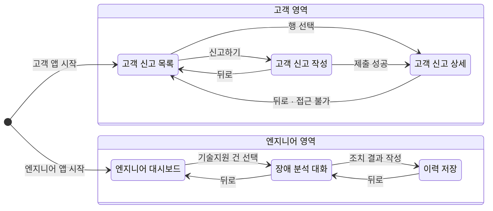
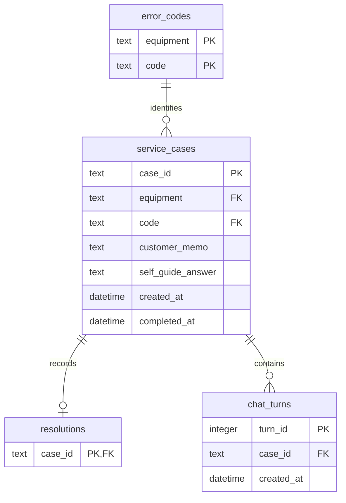

# Spec: M-Pilot 장애 대응 지원

## 목차

- [Spec: M-Pilot 장애 대응 지원](#spec-m-pilot-장애-대응-지원)
  - [목차](#목차)
  - [1. 기능 명세](#1-기능-명세)
    - [1.1 DB 파트](#11-db-파트)
    - [1.2 RAG 파트](#12-rag-파트)
    - [1.3 UI 파트](#13-ui-파트)
  - [2. 시스템 아키텍처](#2-시스템-아키텍처)
    - [2.1 기술 스택](#21-기술-스택)
    - [2.2 프로젝트 트리](#22-프로젝트-트리)
    - [2.3 파트별 모듈 인터페이스](#23-파트별-모듈-인터페이스)
      - [2.3.1 DB 파트](#231-db-파트)
      - [2.3.2 RAG 파트](#232-rag-파트)
      - [2.3.3 UI·총괄 파트](#233-ui총괄-파트)
    - [2.4 공통 계약](#24-공통-계약)
      - [2.4.1 공통 함수](#241-공통-함수)
      - [2.4.2 공통 객체](#242-공통-객체)
    - [2.5 의존 규칙](#25-의존-규칙)
    - [2.6 RAG 규칙](#26-rag-규칙)
    - [2.7 RAG 평가 기준](#27-rag-평가-기준)
    - [2.10 도메인 규칙](#210-도메인-규칙)
      - [경로 결정](#경로-결정)
      - [상태 전이](#상태-전이)
      - [허용 조합](#허용-조합)
      - [이력 취급](#이력-취급)
  - [3. 도메인·데이터 명세](#3-도메인데이터-명세)
    - [3.1 읽는 법과 용어](#31-읽는-법과-용어)
    - [3.3 데이터 모델](#33-데이터-모델)
      - [ERD](#erd)
      - [error_codes](#error_codes)
      - [service_cases](#service_cases)
      - [resolutions](#resolutions)
      - [chat_turns](#chat_turns)
      - [Answer 구조](#answer-구조)
      - [모델에 두지 않는 것](#모델에-두지-않는-것)
    - [3.4 외부 데이터·검색 문서](#34-외부-데이터검색-문서)
      - [data/errorcodes.csv](#dataerrorcodescsv)
      - [data/history_seed.csv](#datahistory_seedcsv)
      - [검색 문서(Chroma)](#검색-문서chroma)
  - [4. 범위와 제약](#4-범위와-제약)

---

## 1. 기능 명세

### 1.1 DB 파트

| 대분류 | 소분류                    | 이벤트                                                                                                                                 |
| ------ | ------------------------- | -------------------------------------------------------------------------------------------------------------------------------------- |
| DB     | PDF 파싱·청킹 (parser)    | 앱을 시작하면 매뉴얼 PDF가 쪽·절 출처가 붙은 검색 자료로 나뉘고, 같은 PDF에서는 항상 같은 결과가 나온다.                               |
| DB     | 초기 자료 적재 (rdb)      | 초기화를 실행하면 에러코드 표와 서비스 이력 200건이 검증된 뒤 저장되고, 오류가 있으면 자동 보정 없이 중단된다.                         |
| DB     | 신고·대화·조치 저장 (rdb) | 고객이 신고하거나 엔지니어가 질문·조치 결과를 등록하면 저장되고, 이미 완료된 건에는 더 저장되지 않는다.                                |
| DB     | 신고 조회 (rdb)           | 고객·엔지니어가 목록이나 상세를 열면 신고와 조치 기록이 최신순·상태별로 보이고, 고객에게는 직접 접수한 신고만 보인다.                  |
| DB     | 검색 색인 (vectordb)      | 앱을 시작하면 매뉴얼과 서비스 이력이 검색 자료로 준비되고, 엔지니어가 조치를 확정하면 다음 질문의 근거로 추가된다(셀프 가이드는 제외). |

### 1.2 RAG 파트

| 대분류 | 소분류                        | 이벤트                                                                                                                            |
| ------ | ----------------------------- | --------------------------------------------------------------------------------------------------------------------------------- |
| RAG    | 근거 검색 (retriever)         | 엔지니어가 질문하면 같은 설비의 매뉴얼·과거 이력에서 근거를 찾고, 고객 신고에서는 지정된 고객 수행 절차만 가져온다.               |
| RAG    | 답변 생성·검증 (generator)    | 고객이나 엔지니어가 요청하면 단계마다 출처가 붙은 답이 나오고, 출처가 근거와 다른 답은 보여주지 않는다.                          |
| RAG    | 고객 안내 흐름 (pipeline)     | 고객이 신고하면 매뉴얼의 고객 수행 절차만으로 셀프 가이드가 나오고, 만들 수 없으면 추측하지 않고 엔지니어에게 접수된다.           |
| RAG    | 엔지니어 답변 흐름 (pipeline) | 엔지니어가 신고 건에서 질문하면 신고한 에러코드를 기준으로 답하고, 신고한 설비의 자료에서 근거를 찾지 못하면 조치 없이 그 사실만 알린다. |
| RAG    | RAG 평가 (pipeline)           | 평가를 실행하면 엔지니어 답변과 고객 안내가 목적별로 문항마다 채점되어 환각·엉뚱한 출처·정답 적중·과잉 보류 건수와 합격 여부가 기록된다. |

### 1.3 UI 파트

| 대분류 | 소분류            | 이벤트                                                                                                                                                                                      |
| ------ | ----------------- | ------------------------------------------------------------------------------------------------------------------------------------------------------------------------------------------- |
| UI     | 고객 신고 목록    | 고객이 자신이 접수한 신고를 최신순·상태별로 보고, 신고를 누르면 상세로, ‘신고하기’를 누르면 작성 화면으로 이동한다.                                                                         |
| UI     | 고객 신고 상세    | 고객이 신고를 열면 진행 상태를 보고, 셀프 가이드 건은 단계별 안내와 출처를 본 뒤 [해결완료](조치 완료)이나 [기술지원접수](조치 중 유지, 엔지니어 이관)를 누르고, 엔지니어 처리 건은 완료 뒤 조치 결과를 본다(내부 분석은 보이지 않는다).                                         |
| UI     | 고객 신고 작성    | 고객이 설비·에러코드를 고르고 제출하면 접수번호가 발급되고, 심각도가 높거나 고객이 조치할 수 없는 고장은 엔지니어에게 접수되며 나머지는 셀프 가이드를 받는다(만들 수 없으면 엔지니어 접수). |
| UI     | 엔지니어 대시보드 | 엔지니어가 기존 서비스 이력과 신규 신고를 상태별로 보고, 건을 누르면 대화창으로 이동한다(완료 건과 고객 확인 전 셀프 가이드 건은 읽기 전용, 이관된 건은 질문 가능).                                                   |
| UI     | 장애 분석 대화    | 엔지니어가 신고 건에서 질문하면 출처가 붙은 답을 받고 첫 질문에 ‘조치 중’이 되며, 근거 부족·대상 아님·AI 오류 때는 안내만 본다.                                                             |
| UI     | 이력 저장         | 엔지니어가 원인·실제 조치·결과를 입력해 완료하면 신고가 ‘조치 완료’가 되어 다음 질문의 근거가 되고, 이미 완료된 건은 ‘이미 완료’로 안내된다.                                                |
| UI     | 앱 공통 (APP)     | 고객 앱(7860)·엔지니어 앱(7861)을 시작하면 검색 자료 준비가 끝난 뒤 역할의 첫 화면(고객 신고 목록·엔지니어 대시보드)이 열리고, 모든 화면에 ‘모든 데이터는 가상’이 보이며 오류는 고정 문구로만 안내된다.                                                       |

---

## 2. 시스템 아키텍처

### 2.1 기술 스택

| 항목          | 결정                            |
| ------------- | ------------------------------- |
| 언어·화면     | Python, Gradio Blocks           |
| LLM·임베딩    | OpenAI API, LangChain           |
| 벡터 DB       | Chroma(메모리)                  |
| 관계형 DB     | MySQL(PyMySQL), SQLAlchemy Core |
| 자료 읽기     | pdfplumber(PDF)                 |
| 패키지 매니저 | pip                             |

### 2.2 프로젝트 트리

```text
.
├── app.py                             # [UI] 앱 조립·실행 공통부: 설정·모듈 초기화, 역할별 화면 생성
├── app_customer.py                    # [UI] 고객 앱 진입점(7860)
├── app_engineer.py                    # [UI] 엔지니어 앱 진입점(7861)
├── mpilot/
│   ├── config.py                      # [공통] 앱 설정 로드·검증
│   ├── models.py                      # [공통] 업무 데이터 정의와 순수 업무 규칙
│   ├── service.py                     # [UI] 화면과 DB·RAG를 잇는 유즈케이즈(접수·질문·완료 등)
│   ├── db/                            # [DB]
│   │   ├── parser/                    # 매뉴얼 PDF를 출처가 붙은 검색 단위로 분해(밖에서는 parse_manuals만 쓴다)
│   │   │   ├── __init__.py            # parse_manuals: 전체 흐름 조립
│   │   │   ├── types.py               # 중간 자료(RawTable, ChunkDraft, TextLine, PageText, Section, Footer)
│   │   │   ├── text.py                # 꼬리글 읽기, 쪽별 본문 추출, 절 나누기·텍스트 초안
│   │   │   ├── tables.py              # 표 추출·검증·표 초안
│   │   │   ├── chunks.py              # 청크 번호 매기기, 청크 ID 중복 검사
│   │   │   ├── cache.py               # 청크 목록 디스크 캐시(PDF·parser가 그대로면 파싱을 건너뛴다)
│   │   │   └── ocr.py                 # [보류] 이미지 페이지 OCR(주석)
│   │   ├── schemas.py                 # 관계형 DB 구조·연결 설정 정의
│   │   ├── rdb/                       # 신고·대화·조치의 저장·조회
│   │   │   ├── __init__.py            # 공개 함수를 다시 내보낸다(밖에서는 rdb.<함수>로 부른다)
│   │   │   ├── _common.py             # 공통 도구: 엔진 보관, 시각·JSON 변환, 행 → 업무 객체
│   │   │   ├── setup.py               # 연결·테이블 생성, 에러코드·시드 이력 적재, 에러코드 조회
│   │   │   ├── cases.py               # 신고 저장(셀프 가이드·지원 요청), 목록·상세 조회
│   │   │   └── chat.py                # 대화 저장·조회, 조치 확정, 확정 이력 조회
│   │   └── vectordb.py                # 검색 자료 저장소 관리(색인 생성·이력 반영·원문 조회)
│   ├── rag/                           # [RAG]
│   │   ├── retriever.py               # 근거 검색
│   │   ├── generator.py               # 모델 호출과 답변 형식·인용 검증
│   │   └── pipeline.py                # 고객 안내·엔지니어 답변의 단계 조립
│   └── ui/                            # [UI]
│       ├── common.py                  # 화면 공통 표시 처리(표기 변환·오류 문구·가상 데이터 배너)
│       ├── customer_dashboard.py      # 고객 신고 목록
│       ├── customer_report_form.py    # 고객 신고 작성
│       ├── customer_report_detail.py  # 고객 신고 상세
│       ├── engineer_dashboard.py      # 엔지니어 대시보드
│       ├── engineer_chat.py           # 장애 분석 대화
│       └── engineer_resolution.py     # 조치 이력 저장
├── fake/                              # [UI] 수동 테스트·시연용 가짜 구현. 사용법·재현 절차는 fake/README.md
│   ├── fake_service.py                # --fake 실행용 가짜 service(원자료 CSV + 메모리). service와 같은 공개 함수
│   ├── fake_db.py                     # 가짜 rdb·vectordb·parser(메모리 + 진짜 Chroma). service·rag는 진짜 코드로 돈다
│   ├── run.py                         # 가짜 DB 위에서 고객·엔지니어 앱 실행(`python -m fake.run`)
│   └── test_*.py                      # 위 가짜들과 실행 진입점의 테스트
├── scripts/
│   ├── init_db.py                     # [DB] DB 초기화·초기 자료 적재 실행
│   ├── build_error_codes.py           # [DB] 원자료 표와 매뉴얼 표로 data/errorcodes.csv 생성
│   ├── build_history_seed.py          # [DB] 원자료 이력 4종으로 data/history_seed.csv 생성
│   └── evaluate.py                    # [RAG] RAG 품질 평가 실행·기록
├── prompts/                           # [RAG] 모델 지시문(고객 안내·엔지니어 대화)
├── tests/                             # 테스트
├── .github/workflows/                 # GitHub CI
├── requirements.txt                   # 의존성 목록
├── .env.example                       # 환경변수
├── data/                              # 데이터. 원자료 아래에 검수한 변환 결과(errorcodes.csv 등)가 추가된다(§3.4)
│   ├── manuals/                       # 설비 매뉴얼 PDF 4종(원자료)
│   ├── raw/                           # 에러코드 표, 설비별 조치 이력 더미 CSV(원자료)
│   └── cache/                         # parse_manuals 청크 캐시(로컬 전용, 지우면 다음 시작 때 다시 만든다)
└── docs/                              # (기존) 의도·스펙 문서
```

### 2.3 파트별 모듈 인터페이스

#### 2.3.1 DB 파트

| 모듈     | 함수 시그니처                                                                                            | 책임                                                           | 예외                                                               |
| -------- | -------------------------------------------------------------------------------------------------------- | -------------------------------------------------------------- | ------------------------------------------------------------------ |
| parser   | `parse_manuals(directory: Path) -> list[Chunk]`                                                          | 매뉴얼 PDF를 출처가 붙은 검색 단위로 분해한다                  | ValidationError, DependencyError                                   |
| rdb      | `connect(db_url: str) -> None`                                                                           | 관계형 DB 연결을 준비한다                                      | ValidationError, DependencyError                                   |
| rdb      | `reset_schema() -> None`                                                                                 | 모든 테이블을 삭제하고 다시 만든다                             | DependencyError                                                    |
| rdb      | `load_error_codes_from_csv(path: Path) -> list[ErrorCode]`                                               | 에러코드 CSV를 검증해 적재한다                                 | ValidationError, DependencyError                                   |
| rdb      | `fetch_error_codes(equipment: Equipment) -> list[ErrorCode]`                                             | 설비별 에러코드를 조회한다                                     | ValidationError, DependencyError                                   |
| rdb      | `load_seed_history_from_csv(path: Path) -> int`                                                          | 시드 이력 CSV를 검증해 적재하고 적재 건수를 반환한다           | ValidationError, DependencyError                                   |
| rdb      | `fetch_cases(status: CaseStatus \| None = None, source: Source \| None = None) -> list[CaseDetail]`      | 신고 목록을 최신순으로 조회한다                                | ValidationError, DependencyError                                   |
| rdb      | `fetch_case_detail(case_id: str) -> CaseDetail`                                                          | 신고 상세를 조회한다                                           | NotFoundError, DependencyError                                     |
| rdb      | `save_self_guide_case(case_id: str, data: CaseInput, guidance_answer: Answer) -> CaseDetail`             | 셀프 가이드 건을 조치 중 상태로 저장한다                       | ValidationError, DependencyError                                   |
| rdb      | `save_support_case(case_id: str, data: CaseInput, guide_failure: GuideFailure \| None) -> CaseDetail`    | 엔지니어 처리 건을 접수 상태로 저장한다                        | ValidationError, DependencyError                                   |
| rdb      | `resolve_self_guide_case(case_id: str) -> CaseDetail`                                                    | 고객이 해결완료를 확인한 셀프 가이드 건을 조치 완료로 바꾼다      | NotFoundError, InvalidStateError, DependencyError                  |
| rdb      | `escalate_self_guide_case(case_id: str) -> CaseDetail`                                                   | 고객이 기술지원접수를 누른 셀프 가이드 건을 엔지니어 처리 건(`route=support`)으로 이관하고 조치 중을 유지한다 | NotFoundError, InvalidStateError, DependencyError |
| rdb      | `fetch_chat_turns(case_id: str) -> list[ChatTurn]`                                                       | 신고의 대화 이력을 조회한다                                    | DependencyError                                                    |
| rdb      | `save_chat_turn(case_id: str, question: str, answer: Answer) -> ChatTurn`                                | 질문·답변을 저장하고 첫 질문이면 조치 중으로 바꾼다            | ValidationError, NotFoundError, InvalidStateError, DependencyError |
| rdb      | `save_confirmed_resolution(case_id: str, record: Resolution) -> CaseDetail`                              | 조치 결과를 저장하고 조치 완료로 확정한다                      | ValidationError, NotFoundError, InvalidStateError, DependencyError |
| rdb      | `fetch_resolved_cases() -> list[CaseDetail]`                                                             | 조치 기록이 있는 신고를 조회한다                               | DependencyError                                                    |
| vectordb | `connect(embeddings: Embeddings) -> None`                                                                | 임베딩을 받아 검색 저장소를 연결한다                           | DependencyError                                                    |
| vectordb | `get_store(kind: CitationKind) -> VectorStore`                                                           | manual 또는 history 저장소를 돌려준다                          | ValidationError, DependencyError                                   |
| vectordb | `get_document(kind: CitationKind, ref_id: str) -> Document`                                              | 문서 ID로 원문·메타데이터를 조회한다                           | NotFoundError, DependencyError                                     |
| vectordb | `index_history(case: CaseDetail) -> None`                                                                | 확정 현장 조치 한 건을 이력 색인에 반영한다                    | ValidationError, DependencyError                                   |
| vectordb | `rebuild_search_index(chunks: list[Chunk], codes: list[ErrorCode], histories: list[CaseDetail]) -> None` | 검색 색인을 새로 만든다                                        | ValidationError, DependencyError                                   |
| init_db  | `main() -> int`                                                                                          | DB 초기화와 초기 자료 적재를 실행하고 성공 0·실패 1을 반환한다 | — (앱 예외는 안내 후 종료 코드 1로 변환)                           |
| build_error_codes | `main() -> int`                                                                                 | 원자료 표와 매뉴얼 표로 에러코드 정본 CSV를 만들고 성공 0·실패 1을 반환한다 | — (앱 예외는 안내 후 종료 코드 1로 변환)                  |
| build_history_seed | `main() -> int`                                                                                | 원자료 이력 4종을 시드 이력 CSV로 바꾸고 성공 0·실패 1을 반환한다 | — (앱 예외는 안내 후 종료 코드 1로 변환)                  |

#### 2.3.2 RAG 파트

| 모듈      | 함수 시그니처                                                                                           | 책임                                      | 예외                             |
| --------- | ------------------------------------------------------------------------------------------------------- | ----------------------------------------- | -------------------------------- |
| retriever | `search(kind: CitationKind, equipment: Equipment \| None, query: str, k: int, code: str \| None = None) -> list[SearchHit]` | 설비 필터로 `manual` 또는 `history` 근거를 검색한다(`None`이면 필터 없이 4종 전체, 폴백 전용). `code`를 주면 다른 코드의 문서를 검색 전에 빼고(메타데이터 `code`가 신고 코드이거나 공통 절 표시값 `common`인 문서만) 최대 k건을 돌려준다 | ValidationError, DependencyError |
| retriever | `fetch_code_documents(equipment: Equipment, code: str) -> list[SearchHit]` | 신고 코드의 고객용 `manual` 근거(코드 표 행과 그 절의 `엔지니어 조치 절차` 앞까지, 원인 후보 표 포함)를 유사도 검색 없이 원문 순서로 가져온다 | DependencyError |
| generator | `set_chat_model(chat_model: BaseChatModel) -> None`                                                     | 답변 생성에 쓸 모델을 설정한다            | —                                |
| generator | `generate_customer_guidance(context: CaseContext, hits: list[SearchHit]) -> Answer`                     | 고객 안내 답변을 생성한다                 | DependencyError                  |
| generator | `generate_engineer_answer(context: CaseContext, hits: list[SearchHit], request: ChatRequest, cross_equipment: bool = False) -> Answer` | 엔지니어 대화 답변을 생성한다(`cross_equipment`는 다른 설비 근거가 섞인 폴백일 때 `True`) | DependencyError                  |
| generator | `passes_check(answer: Answer, hits: list[SearchHit], equipment: Equipment, allow_other_equipment: bool = False) -> bool` | 고객 안내·엔지니어 답변의 인용을 검사한다(`allow_other_equipment`는 폴백 답변에서만 `True`) | —                                |
| pipeline  | `run_customer_guidance(context: CaseContext, settings: SearchSettings) -> Answer`                       | 고객 안내 처리 흐름을 실행한다. 셀프 가이드 후보가 아닌 코드는 검색 없이 보류한다 | DependencyError |
| pipeline  | `run_engineer_answer(context: CaseContext, request: ChatRequest, settings: SearchSettings) -> Answer`   | 엔지니어 답변 처리 흐름을 실행한다        | ValidationError, DependencyError |
| pipeline  | `search_customer_evidence(context: CaseContext, settings: SearchSettings) -> list[SearchHit]`           | 고객 안내의 근거 조회만 실행한다(`run_customer_guidance`가 쓴다, `fetch_code_documents`). 평가가 생성 없이 같은 조회를 잰다. `settings`는 쓰지 않는다 | DependencyError |
| pipeline  | `search_engineer_evidence(context: CaseContext, question: str, settings: SearchSettings) -> list[SearchHit]` | 엔지니어 1차 근거 검색만 실행한다(`run_engineer_answer`가 쓴다). `question`은 공백을 지운 질문. 폴백은 `retriever.search`를 질문 원문·`equipment=None`으로 부른다 | ValidationError, DependencyError |
| evaluate  | `run_eval(questions_path: Path, output_dir: Path) -> dict[str, object]`                                 | 평가 문항을 실행하고 결과를 기록한다      | ValidationError, DependencyError |

#### 2.3.3 UI·총괄 파트

**모듈 인터페이스**

| 모듈                      | 함수 시그니처                                                                                      | 책임                                                                             | 예외                                                               |
| ------------------------- | -------------------------------------------------------------------------------------------------- | -------------------------------------------------------------------------------- | ------------------------------------------------------------------ |
| ui/customer_dashboard     | `build_customer_dashboard_screen(role: gr.State, case_id: gr.State, screen: gr.State) -> None`     | 고객 본인의 신고 목록을 최신순·상태별로 보여 준다                                | —                                                                  |
| ui/customer_report_form   | `build_customer_report_form_screen(role: gr.State, case_id: gr.State, screen: gr.State) -> None`   | 설비·에러코드·증상 메모를 입력받아 신고를 제출한다                               | —                                                                  |
| ui/customer_report_detail | `build_customer_report_detail_screen(role: gr.State, case_id: gr.State, screen: gr.State) -> None` | 신고의 진행 상태와 셀프 가이드 박스 또는 조치 결과를 보여 준다(출처 원문은 펼치지 않는다) | —                                                                  |
| ui/engineer_dashboard     | `build_engineer_dashboard_screen(role: gr.State, case_id: gr.State, screen: gr.State) -> None`     | 시드 이력을 포함한 전체 신고를 상태별로 보여 주고 대응할 건을 선택받는다         | —                                                                  |
| ui/engineer_chat          | `build_engineer_chat_screen(role: gr.State, case_id: gr.State, screen: gr.State) -> None`          | 신고 정보와 대화를 보여 주고 질문 전송·출처 원문 확인을 처리한다                 | —                                                                  |
| ui/engineer_resolution    | `build_engineer_resolution_screen(role: gr.State, case_id: gr.State, screen: gr.State) -> None`    | 원인·실제 조치·결과를 입력받아 조치 완료로 등록한다                              | —                                                                  |
| service                   | `set_config(config: AppConfig) -> None`                                                            | 앱 설정을 보관한다                                                               | —                                                                  |
| service                   | `list_customer_cases(status: CaseStatus \| None = None) -> list[CustomerCaseResult]`               | 고객 본인의 신고를 공개 필드로 조회한다                                          | ValidationError, DependencyError                                   |
| service                   | `get_customer_case(case_id: str) -> CustomerCaseResult`                                            | 고객 공개 신고 상세를 조회한다                                                   | NotFoundError, DependencyError                                     |
| service                   | `resolve_self_guide(case_id: str) -> None`                                                         | 고객이 셀프 가이드로 해결됐다고 확인한 건을 조치 완료로 바꾼다                   | NotFoundError, InvalidStateError, DependencyError                  |
| service                   | `request_support(case_id: str) -> None`                                                            | 고객이 해결되지 않았다고 한 셀프 가이드 건을 엔지니어 처리 건으로 이관한다(조치 중 유지) | NotFoundError, InvalidStateError, DependencyError |
| service                   | `list_error_codes(equipment: Equipment) -> list[ErrorCode]`                                        | 설비별 에러코드 선택지를 조회한다                                                | ValidationError, DependencyError                                   |
| service                   | `submit_case(data: CaseInput) -> str`                                                              | 신고를 접수하고 처리 경로를 확정한 뒤 접수번호를 반환한다                        | ValidationError, DependencyError                                   |
| service                   | `list_engineer_cases(status: CaseStatus \| None = None) -> list[CaseDetail]`                       | 엔지니어용 전체 신고 목록을 조회한다                                             | ValidationError, DependencyError                                   |
| service                   | `get_engineer_case(case_id: str) -> CaseDetail`                                                    | 신고·에러코드·현장 조치를 조회한다                                               | NotFoundError, DependencyError                                     |
| service                   | `list_chat_turns(case_id: str) -> list[ChatTurn]`                                                  | 신고의 대화 이력을 조회한다                                                      | NotFoundError, DependencyError                                     |
| service                   | `send_chat_question(case_id: str, question: str) -> None`                                          | 엔지니어 질문에 답하고 대화를 저장한다                                           | ValidationError, NotFoundError, InvalidStateError, DependencyError |
| service                   | `confirm_resolution(case_id: str, record: Resolution) -> tuple[CaseDetail, bool]`                  | 조치 결과를 확정하고 검색 근거에 반영하며, 반환의 `bool`은 검색 반영 성공 여부다 | ValidationError, NotFoundError, InvalidStateError, DependencyError |
| service                   | `get_citation_text(citation: Citation) -> str`                                                     | 인용 출처의 원문을 조회한다                                                      | NotFoundError, DependencyError                                     |
| service                   | `prepare_search_index() -> None`                                                                   | 검색 색인을 원자료로 새로 만든다                                                 | ValidationError, DependencyError                                   |
| app                       | `main(role: Role, port: int, argv: Sequence[str] \| None = None) -> None`                          | 역할의 앱을 조립해 실행한다(`--fake`면 초기화 없이 가짜 데이터로 화면만 띄운다) | SystemExit(초기화 실패 시 고정 문구 출력 후 종료)                  |

**화면–서비스 연결**

| 화면              | 사용하는 서비스 함수                                                              |
| ----------------- | --------------------------------------------------------------------------------- |
| 고객 신고 목록    | `list_customer_cases`                                                             |
| 고객 신고 작성    | `list_error_codes`, `submit_case`                                                 |
| 고객 신고 상세    | `get_customer_case`, `resolve_self_guide`, `request_support`                      |
| 엔지니어 대시보드 | `list_engineer_cases`                                                             |
| 장애 분석 대화    | `get_engineer_case`, `list_chat_turns`, `send_chat_question`, `get_citation_text` |
| 이력 저장         | `get_engineer_case`, `confirm_resolution`                                         |

**화면 전환**



### 2.4 공통 계약

#### 2.4.1 공통 함수

| 모듈   | 함수 시그니처                                             | 책임                                                                     | 예외                             |
| ------ | --------------------------------------------------------- | ------------------------------------------------------------------------ | -------------------------------- |
| config | `load_config(env_path: Path \| None = None) -> AppConfig` | .env·환경 변수를 로드해 설정을 검증한다                                  | ValidationError, DependencyError |
| models | `is_self_guide_candidate(error_code: ErrorCode) -> bool`  | 심각도·조치 구분만으로 셀프 가이드 후보 여부를 판정한다(§2.10 경로 결정) | —                                |
| models | `raise_if_case_completed(case: ServiceCase) -> None`      | 완료된 건과 이관 전 셀프 가이드 건의 질문 저장을 차단한다(§2.10 상태 전이) | InvalidStateError                |

#### 2.4.2 공통 객체

**예외·열거형**

| 객체                    | 필드                                                                                                                                                                                                           | 책임                                                         |
| ----------------------- | -------------------------------------------------------------------------------------------------------------------------------------------------------------------------------------------------------------- | ------------------------------------------------------------ |
| `MpilotError` 하위 예외 | `ValidationError`(입력 오류·로그인 실패·미등록 코드), `NotFoundError`(없는 접수번호·코드·원문), `InvalidStateError`(상태 규칙 위반: 이미 완료·이관 전 셀프 가이드 건·이미 해결 여부를 답한 셀프 가이드 건), `DependencyError`(DB·모델·검색 장애, 시간 초과) | 실패 원인(입력·없음·상태·의존)을 구분해 화면에 전달한다.     |
| `Equipment`             | 값: `Mini Loader`, `SRM`, `AGV`, `RTV`                                                                                                                                                                         | 신고 대상 설비 4종을 정한다.                                 |
| `Severity`              | 값: `상`, `중`, `하`                                                                                                                                                                                           | 에러코드 표의 심각도를 나타낸다.                             |
| `ActionOwner`           | 값: `고객사 조치`, `엔지니어 필요`                                                                                                                                                                             | 에러코드 표의 조치 구분을 나타낸다.                          |
| `CaseStatus`            | 값: `received`, `in_progress`, `completed`                                                                                                                                                                     | 신고의 진행 단계를 나타낸다.                                 |
| `Route`                 | 값: `self_guide`, `support`                                                                                                                                                                                    | 신고가 셀프 가이드인지 엔지니어 처리인지 나타낸다.           |
| `GuideFailure`          | 값: `held`, `generation_failed`, `unresolved`                                                                                                                                                                  | 셀프 가이드 후보가 엔지니어 접수된 사유를 나타낸다. `unresolved`는 안내를 받은 고객이 기술지원접수를 눌러 이관한 경우다. |
| `Source`                | 값: `seed`, `reported`                                                                                                                                                                                         | 신고가 시드 이력인지 앱에서 접수한 건인지 나타낸다.          |
| `Verdict`               | 값: `answered`, `insufficient_evidence`                                                                                                                                                      | 답변이 답변됨·근거 부족 중 무엇인지 나타낸다. |
| `CitationKind`          | 값: `manual`, `history`                                                                                                                                                                                        | 인용 종류(매뉴얼·이력)를 나타낸다.                           |
| `Role`                  | 값: `customer`, `engineer`                                                                                                                                                                                     | 로그인 역할(고객·엔지니어)을 구분한다.                       |

**신고**

| 객체                 | 필드                                                                                                                                                                                                                         | 책임                                                                                                              |
| -------------------- | ---------------------------------------------------------------------------------------------------------------------------------------------------------------------------------------------------------------------------- | ----------------------------------------------------------------------------------------------------------------- |
| `ErrorCode`          | `equipment`, `code`, `name`, `severity: Severity`, `action_owner: ActionOwner`, `cause`, `action`, `manual_id`, `page: int`, `section`          | 에러코드 표 한 행으로, 경로 결정과 답변의 근거가 된다.                                                            |
| `CaseInput`          | `equipment: Equipment`, `code: str`, `memo: str \| None`                                                                                                                                                                     | 고객이 제출한 신고 입력값을 담는다.                                                                               |
| `ServiceCase`        | `case_id`, `equipment`, `code`, `memo: str \| None`, `source: Source`, `status`, `route`, `guide_failure: GuideFailure \| None`, `guidance_answer: Answer \| None`, `created_at: datetime`, `completed_at: datetime \| None` | 신고 건 하나의 현재 상태를 담는다.                                                                                |
| `Resolution`         | `cause`, `action`, `result`                                                                                                                                                                                                  | 엔지니어가 작성한 원인·조치·결과이며 입력과 확정 기록이 같은 구조다(셀프 가이드는 `ServiceCase.guidance_answer`). |
| `CaseDetail`         | `service_case: ServiceCase`, `error_code: ErrorCode`, `resolution: Resolution \| None`                                                                                                                                       | 신고·에러코드·조치 기록을 묶는다. 목록과 상세에서 함께 쓴다.                                                      |
| `CustomerCaseResult` | `case_id`, `equipment`, `code`, `error_name`, `memo: str \| None`, `status`, `route`, `created_at`, `guidance_answer: Answer \| None`, `action: str \| None`, `result: str \| None`                                                   | 고객 목록·상세의 공개 필드만 담는다. 내부 원인·guide_failure 제외.                                                |

**대화·답변**

| 객체         | 필드                                                                  | 책임                                                   |
| ------------ | --------------------------------------------------------------------- | ------------------------------------------------------ |
| `ChatTurn`   | `turn_id: int`, `case_id`, `question`, `answer: Answer`, `created_at` | 저장된 대화 한 턴을 담는다.                            |
| `Answer`     | `verdict`, `steps: list[AnswerStep]`, `notice: str \| None`           | RAG 답변의 판정·단계·안내 문구를 담는 구조화 출력이다. |
| `AnswerStep` | `text`, `citations: list[Citation]`                                   | 답변의 조치 단계 한 개와 그 출처를 담는다.             |
| `Citation`   | `kind: CitationKind`, `ref_id`, `locator`                             | 답변 단계가 가리키는 근거를 식별한다.                  |

**RAG 전달**

| 객체             | 필드                                                                                             | 책임                                                                     |
| ---------------- | ------------------------------------------------------------------------------------------------ | ------------------------------------------------------------------------ |
| `CaseContext`    | `error_code: ErrorCode`, `memo: str \| None`                                                     | 신고 맥락(신고 코드의 상세와 증상 메모)을 pipeline·generator에 전달한다. |
| `ChatRequest`    | `question: str`, `turns: list[ChatTurn]`                                                         | 엔지니어의 현재 질문과 저장된 대화를 한 번에 전달한다.                   |
| `SearchHit`      | `ref_id`, `kind`, `equipment`, `code: str \| None`, `text`, `locator`, `distance: float \| None` | 검색 결과 한 건을 담는다.                                                |
| `SearchSettings` | `manual_k: int`, `history_k: int`                                   | 엔지니어 검색 설정을 담는다.                                             |
| `Chunk`          | `manual_id`, `equipment`, `page: int`, `section`, `chunk_no: int`, `version`, `text`             | 매뉴얼 청크 한 개와 출처 메타데이터를 담는다.                            |

**설정(`config.py`)**

| 객체          | 필드                                                                                                                                                                                                                                                    | 책임                                                                 |
| ------------- | ------------------------------------------------------------------------------------------------------------------------------------------------------------------------------------------------------------------------------------------------------- | -------------------------------------------------------------------- |
| `AppConfig`   | `db_url: SecretStr`, `openai_api_key: SecretStr`, `chat_model_name`, `embedding_model_name`, `manuals_dir`, `codes_path`, `history_seed_path`, `search: SearchSettings`, `llm_timeout_seconds: float`(기본 60), `demo_accounts: dict[str, DemoAccount]` | 앱 설정(DB·모델·경로·검색 파라미터·데모 계정)을 담는다(`config.py`). |
| `DemoAccount` | `login_id`, `password: SecretStr`, `role: Role`                                                                                                                                                                                                         | 데모 로그인 계정을 담는다(`config.py`).                              |

### 2.5 의존 규칙

**의존 방향**

```text
app_customer.py, app_engineer.py ──→ app
app.py ──→ ui/*, service, fake/fake_service, config, models, db/rdb, db/vectordb, rag/generator
service ──→ db/parser, db/rdb, db/vectordb, rag/pipeline, config, models
fake/fake_service ──→ service(바꿔 끼울 대상), config, models (app의 --fake만 install을 부른다)
fake/fake_db ──→ fake/fake_service(CSV 로더·조회 도우미), db/parser, db/rdb, db/vectordb(바꿔 끼울 대상), models (fake/run만 install을 부른다)
fake/run ──→ app, fake/fake_db, db/vectordb, rag/generator
mpilot/* ──✗ fake/* (운영 코드는 fake를 import하지 않는다)
rag/pipeline ──→ rag/retriever, rag/generator, models
rag/retriever ──→ db/vectordb, models
db/rdb ──→ db/schemas, models
config, db/parser, db/schemas, db/vectordb, rag/generator ──→ models
scripts ──→ config, db/parser, db/rdb, models
scripts/evaluate ──→ app(initialize로 색인·모델 준비), rag/pipeline, rag/generator(채팅 모델을 temperature=0으로 교체), rag/retriever(검색 지표의 폴백 검색)
```

### 2.6 RAG 규칙

- 엔지니어 검색 개수는 manual 상위 11건(`manual_k`)·history 상위 5건(`history_k`)이 기본이다(실측 평가로 3건에서 올림).
- 엔지니어 1차 `manual` 검색은 질문 원문을 질의로, 신고 설비이면서 신고 코드이거나 공통 절(색인 때 `code="common"`)인 문서만 찾는다. 질의에 코드·이름을 붙이면 신고 코드 절만 끌려와 공통 절을 놓치기 때문이다. `history`는 코드로 거르지 않으므로 `<코드> <이름> <질문>`으로 찾는다.
- 대화 이력은 생성 입력에서만 줄이고 저장된 이력은 지우지 않는다.
- 원문 밖의 원인·절차를 단정하지 않고, 증상 메모는 확인된 사실과 구분한다(프롬프트 규칙).
- 고객 안내(`customer_guidance`)는 셀프 가이드 후보 코드만 만든다(후보가 아니면 모델을 부르지 않고 보류). 근거는 신고 코드의 `manual` 절을 유사도 검색 없이 통째로 쓰되(코드 표 행과 그 코드 절 청크, 폴백 없음), `엔지니어 조치 절차` 제목부터는 빼고 원인 후보 표만 남긴다. 상위 k건만 쓰면 여러 청크에 걸친 고객 절차가 잘려 보류되고, 엔지니어 절차가 근거에 있으면 모델이 그것을 고객에게 안내하기 때문이다. 근거가 없거나 모델이 근거 부족으로 판정하면 보류(`held`)다. `history` 컬렉션은 엔지니어 대화(`engineer_chat`)에서만 검색·인용한다.
- 대상 코드는 신고 코드로 고정하며 pipeline 입력 계약은 §2.3.2를 따른다. 4종 밖 설비·다른 설비·사전에 없는 주제·다른 코드를 묻는 질문도 먼저 신고 설비 필터로 검색한다. 보류 여부는 설비·키워드·검색 거리로 미리 거르지 않고, 검색 결과로 답할 수 있는지를 모델이 판정한다(검색 거리 임계값은 두지 않는다). 엔지니어 답변에서 모델이 신고 설비 자료로 근거 부족이라 판정하면 설비 필터 없이 4종 전체를 질문 원문으로 한 번 더 검색해 다시 생성한다(폴백). 폴백 근거로 답하면 인용의 설비가 신고 설비와 달라도 통과시키고 `Answer.notice`에 다른 설비 자료를 포함했다는 고정 문구를 담으며, 그래도 근거가 없으면 insufficient_evidence다.
- 파이프라인은 근거 확보 → 생성 → 검증 순이다. 고객 근거는 신고 코드의 `manual` 검색, 엔지니어 근거는 `manual`·`history` 검색이다. 근거 부족은 steps=[]인 Answer이며, 모델·검색 장애와 검증 실패는 DependencyError다. 저장은 service가 담당한다.
- 출처 ID 검증은 내용의 정확성·안전성을 증명하지 않는다. 그 부분은 프롬프트 제약과 사람의 사후 평가로 나눈다. 건별 사전 승인은 없다.

### 2.7 RAG 평가 기준

`scripts/evaluate`가 `data/eval_questions.csv`로 엔지니어 대화(`run_engineer_answer`)와 고객 안내(`run_customer_guidance`)를 문항별로 실행하고, 결과를 한 개의 dict로 `output_dir`에 JSON으로 남긴다. CI가 아니라 수동으로 실행한다. 지표와 합격선은 목적(`engineer_chat`·`customer_guidance`)별로 따로 센다.

**문항**

- 열: `purpose`, `equipment`, `code`, `question`, `expected`, `state`, `gold_ref_ids`. `purpose`는 `engineer_chat` 또는 `customer_guidance`다. `equipment`·`code`는 신고한 에러코드(에러코드 표에 있어야 한다)이고, `expected`는 `answered`(답변 가능) 또는 `insufficient_evidence`(답변 불가)다. `state`는 문항의 성격이며 목적마다 허용값이 다르고 `expected`와 짝이어야 한다(아래 표). `gold_ref_ids`는 정답 근거 문서 ID(§3.4)의 JSON 배열이다.
- `state`는 시스템의 분기(§2.6)를 문항에 드러낸다. 엔지니어 대화는 **자료 범위**(신고 설비 `own`·다른 설비 `other`·4종 어디에도 없음 `none`)와 **질문 성격**(`code` 에러코드 절, `common` 코드 없는 공통 본문, `history` 과거 이력)으로 나눈다. 공통 본문은 안전 수칙·점검·구조 등 `code`가 없는 매뉴얼 청크다.

  | 목적 | state | expected | 질문과 정답 근거(`gold_ref_ids`) |
  | --- | --- | --- | --- |
  | 엔지니어 | `own_code` | answered | 신고 코드 자체의 질문. 신고 설비 매뉴얼의 그 코드 절(·`error:` 행) |
  | 엔지니어 | `own_common` | answered | 신고 설비 매뉴얼의 공통 본문으로 답하는 질문 |
  | 엔지니어 | `own_history` | answered | 같은 설비·코드의 과거 이력이 핵심인 질문. `history:` 문서 |
  | 엔지니어 | `other_code` | answered | 다른 설비의 에러코드를 묻는 질문. 폴백으로 답하며 그 설비의 코드 절 |
  | 엔지니어 | `other_common` | answered | 다른 설비의 공통 본문에만 근거가 있는 질문. 폴백으로 답하며 그 공통 본문 |
  | 엔지니어 | `none_code` | insufficient_evidence | 에러코드 질문이지만 4종 어디에도 근거 없음. `[]` |
  | 엔지니어 | `none_common` | insufficient_evidence | 코드와 무관한 주제로 4종 어디에도 근거 없음. `[]` |
  | 고객 안내 | `guided` | answered | 셀프 가이드 후보 코드. 신고 코드 매뉴얼의 고객 수행 절차 |
  | 고객 안내 | `not_guided` | insufficient_evidence | 엔지니어 필요 코드를 고객 흐름에 직접 투입. `[]` |

- 엔지니어 대화 문항: `question`은 엔지니어의 질문이며 비울 수 없다. 답변 가능(`own_*`·`other_*`)은 `gold_ref_ids`가 비어 있지 않고, 답변 불가(`none_*`)는 4종 어디에도 근거가 없으며 `[]`다. `other_*`는 신고 설비 자료만으로 답할 수 없는 질문이라 폴백이 필요하다(§2.6).
- 고객 안내 문항: `question`은 신고 증상 메모이며 비워도 된다(비우면 메모 없이 실행한다).
  - `guided`: `code`는 셀프 가이드 후보(심각도 `상` 아님, 조치 구분 `고객사 조치`, §2.10)여야 한다. 고객 안내는 폴백이 없으므로 신고 설비의 신고 코드 자료만 정답이 될 수 있다(§2.6).
  - `not_guided`: 조치 구분이 엔지니어 필요인 코드(매뉴얼에 고객이 수행할 수 있는 절차가 없는 코드)를 고객 안내 흐름에 직접 넣어 만든다. 운영에서는 경로 분기가 먼저 엔지니어에게 접수하므로, 이 문항은 고객에게 엔지니어 조치를 안내하지 않는 안전 장치를 시험한다. 후보 검사를 하지 않는다. 심각도 `상`이면서 고객사 조치인 코드는 후보가 아니지만 매뉴얼에 고객 절차가 있어 시스템이 답을 만드므로 이 상태에 쓰지 않는다.
- 다른 설비·컨베이어를 언급해도 신고 설비 자료에 근거가 있으면 `own_*` 문항이다.
- 규모: 목적마다 답변 가능 30개 이상, 답변 불가 20개 이상이며 설비 4종에 나눈다. 한 목적이라도 모자라면 평가 미완료다(합격 여부를 판정하지 않는다). 상태별 최소 개수는 검증하지 않는다.
- 문항은 데이터를 만든 사람이 아닌 다른 사람이 쓴다(AI가 쓴 초안은 사람이 검토한다).

**지표**

| 지표        | 분모      | 센 것                                                           | 합격선         |
| ----------- | --------- | --------------------------------------------------------------- | -------------- |
| 환각        | 답변 불가 | verdict=answered가 된 건                                        | 1건 이하       |
| 엉뚱한 출처 | 답변 가능 | verdict=answered인데 인용이 아래 정답 근거 기준에 못 미치는 건  | 1건 이하       |
| 정답 적중   | 답변 가능 | verdict=answered이고 인용이 아래 정답 근거 기준을 만족하는 건   | 21건 이상(70%) |
| 과잉 보류   | 답변 가능 | verdict=insufficient_evidence가 된 건                           | 없음           |
| 생성 실패   | 전체      | `DependencyError`(인용 검증 실패 포함)가 난 건                  | 1건 이하       |

- 답변 가능 문항의 결과는 정답 적중, 과잉 보류, 엉뚱한 출처, 생성 실패 중 하나다. 과잉 보류에 합격선을 따로 두지 않는 것은 정답 적중 하한이 보류를 제한하기 때문이다(보류와 생성 실패를 합쳐 최대 9건).
- 합격은 목적마다 환각·엉뚱한 출처·정답 적중·생성 실패 네 조건을 모두 만족하는 것이다. 전체 합격은 두 목적이 모두 합격일 때다. 두 목적이 같은 `manual_k`를 공유하기 때문이다(§2.6).
- 정답 근거 기준: 두 목적 모두 인용에 `gold_ref_ids`가 하나라도 있으면 만족한다. 다른 인용이 섞여 있어도 엉뚱한 출처로 세지 않는다(인용 단위 정밀도는 재지 않는다). 고객 안내 근거는 신고 코드 절만 조회하므로 다른 코드의 절차는 인용될 수 없다. 같은 코드 절 안의 엔지니어 절차를 안내했는지는 사람 검수(고객 안내 전부)로 확인한다.
- 생성 실패(`DependencyError`)는 별도로 센다. 답변 가능 문항에서는 정답 적중에 들어가지 않고, 답변 불가 문항에서는 환각이 아니다. 인용의 실재·설비 일치는 pipeline이 매번 검증하며 실패가 곧 생성 실패이므로 인용 검증을 별도 지표로 세지 않는다. 지어낸 인용이 생성 실패로 오므로 목적마다 1건 이하여야 합격이다(일시 장애로 넘으면 다시 실행한다).
- 검색 개수(k): 근거 충분 판정은 모델이 하므로(§2.6) 조정 대상은 `manual_k`·`history_k`다. 후보 k마다 평가를 따로 실행하고(결과 JSON이 설정을 함께 남긴다), 두 목적 모두 세 조건을 만족하는 후보 중 과잉 보류가 가장 적은 값을 사람이 고른다. 두 목적의 과잉 보류를 어떻게 합쳐 비교할지는 첫 실측 뒤 정한다. 동률이면 더 작은 k다. 만족하는 후보가 없으면 불합격이며 검색·생성 중 원인을 조사한다. 합격선을 바꾸면 이유를 평가 결과에 남긴다.
- 검색 지표(#97에서 구현): 답변 지표만으로는 과잉 보류가 검색 탓인지 생성 탓인지 가를 수 없어, 문항의 `gold_ref_ids`로 검색 단계도 잰다. 주 지표는 Recall@k(정답 근거 중 상위 k건에 든 비율), 보조는 Hit@k(하나라도 든 문항 비율)와 MRR(첫 정답 순위의 역수 평균)이다. `manual`과 `history`는 각자 상위 k건을 따로 뽑으므로 `gold_ref_ids`를 `history:` 접두로 나눠 컬렉션별로 센다. k별 값은 그 k 후보의 평가 실행에서 운영과 같은 k로 검색한 결과로 계산한다. 신고 코드의 `manual` 검색은 k의 배수를 가져와 다른 코드 청크를 거르므로, 큰 k의 결과를 잘라 쓰면 운영보다 정답을 많이 담을 수 있다. 합격선은 두지 않고 k 선택과 검색 구성 변경 비교에만 쓴다. 폴백 검색은 1차와 구분해 기록한다.
- 정답 적중 70%는 초기 목표이며 실측 결과가 아니다. 첫 실측 뒤 바꿀 수 있다. 고객 안내의 합격선은 엔지니어 대화와 같은 값으로 시작한다.
- 기록 항목: `versions`(모델 이름, 프롬프트·문항 파일 해시), `settings`(검색 설정), `results`(문항별 목적·상태·판정·인용·폴백 안내 여부·결과 분류), `summary`(목적별 건수·합격선·합격 여부와 전체 합격 여부), `caveats`(아래 해석 주의).
- 상태별 집계: 목적별 `summary`의 `by_state`가 상태마다 문항 수와 결과 분류 건수를 센다. 엔지니어 대화는 답한 문항 중 폴백 안내가 기대(`other_*`는 있음, `own_*`는 없음)와 어긋난 건수(`fallback_mismatch`)도 센다. 합격 조건에는 쓰지 않으며 어느 상태에서 실패하는지 가리는 데 쓴다. 폴백 안내 여부는 `Answer.notice`가 폴백 고정 문구인지로 판단한다.

**해석 주의 (작은 표본)**

- 합격선은 이 문항 안의 결정 규칙이며 실제 환각률의 보증이 아니다. 환각이 0건이어도 답변 불가 20개 기준으로 실제 환각률의 95% 상한은 약 14%다. 정답 적중 21건 이상은 실제 적중률 70%인 시스템도 약 41%가 불합격하고 80%인 시스템은 약 94%가 합격하는 경계다. 두 목적을 모두 합격해야 하므로 전체 합격의 우연 불합격 확률은 이보다 크다.
- k 선택과 합격 판정에 같은 문항을 쓰므로 수치가 실제보다 낙관적이다.
- 평가 실행의 채팅 모델은 `temperature=0`으로 만든다. 그래도 호출 결과가 실행마다 완전히 같지는 않을 수 있다.

**사람 검수와 안전 수칙**

- 사람 검수는 생성된 고객 안내 전부와 엔지니어 answered 답변 최소 5건을 대상으로 한다. 인용 원문이 답을 뒷받침하는지, 고객 안내가 고객이 수행할 수 있는 절차만 포함하는지 확인하고 기록한다. 엔지니어 답변이 5건 미만이면 전부 검수하되 표본 부족을 기록하고 최소 검수 조건을 충족한 것으로 처리하지 않는다.
- 근거 없는 조치·금지 절차가 발견되면 수정 후 재평가한다. 고객 안내의 안전 수칙 준수는 자동으로 검증하지 않으므로 사람 검수로만 확인한다.

### 2.10 도메인 규칙

#### 경로 결정

`is_self_guide_candidate`는 에러코드 표의 심각도·조치 구분만 써서 셀프 가이드 후보 여부를 결정한다.

| 순서 | 조건                    | 후보 여부             |
| ---- | ----------------------- | --------------------- |
| 1    | 심각도 `상`             | 아니오(`support`)     |
| 2    | 조치 구분 `고객사 조치` | 예(`self_guide` 후보) |
| 3    | 그 밖                   | 아니오(`support`)     |

| 가이드 결과                                                   | 최종 경로    | `guide_failure`              |
| ------------------------------------------------------------- | ------------ | ---------------------------- |
| `answered`                                                    | `self_guide` | NULL(`guidance_answer` 저장) |
| 보류(근거 부족)                               | `support`    | `held`                       |
| 모델·검색 장애, 제한 시간 초과, 인용·설비 검증 실패           | `support`    | `generation_failed`          |

#### 상태 전이

| 이벤트(함수)                                | 현재 상태                         | 조건              | 다음 상태                | 조건을 못 지키면                 |
| ------------------------------------------- | --------------------------------- | ----------------- | ------------------------ | -------------------------------- |
| 신고 접수(`save_support_case`)              | (없음)                            | 경로 `support`    | `received`               | —                                |
| 신고 접수(`save_self_guide_case`)           | (없음)                            | 경로 `self_guide` | `in_progress`            | —                                |
| [해결완료](`resolve_self_guide_case`)         | `in_progress`                     | `self_guide`      | `completed`              | `InvalidStateError`              |
| [기술지원접수](`escalate_self_guide_case`)      | `in_progress`                     | `self_guide`      | `in_progress`(경로가 `support`로, `guide_failure=unresolved`) | `InvalidStateError` |
| 첫 질문 저장(`save_chat_turn`)              | `received`                        | `support`         | `in_progress`            | —                                |
| 질문 저장                                   | `in_progress`                     | `support`         | `in_progress`(전이 없음) | —                                |
| 조치 결과 등록(`save_confirmed_resolution`) | `received`, `in_progress`         | `support`         | `completed`              | —                                |
| 질문 저장, 조치 결과 등록                   | `completed`, 또는 경로 `self_guide`(이관 전) | —     | —                        | `InvalidStateError`(‘이미 완료’·‘셀프 가이드 건’) |

#### 허용 조합

| 구분                          | `route`      | `guide_failure`            | 접수 직후 상태 | `guidance_answer` | `resolutions` 행      |
| ----------------------------- | ------------ | -------------------------- | -------------- | ----------------- | --------------------- |
| 신고, 셀프 가이드             | `self_guide` | NULL                       | `in_progress`(해결완료를 누르면 `completed`) | 있음 | 없음 |
| 신고, 엔지니어 처리(상·그 밖) | `support`    | NULL                       | `received`     | NULL              | 없음. 등록하면 생긴다 |
| 신고, 가이드 실패             | `support`    | `held`·`generation_failed` | `received`     | NULL              | 없음. 등록하면 생긴다 |
| 신고, 셀프 가이드 기술지원접수(이관) | `support` | `unresolved`               | `in_progress`  | 있음(고객이 받은 안내) | 없음. 등록하면 생긴다 |
| 시드                          | `support`    | NULL                       | `completed`    | NULL              | 있음                  |

#### 이력 취급

| 구분                           | 보존                                                                                     | 검색 근거(`history` 인덱스)                          | 뜻                                           |
| ------------------------------ | ---------------------------------------------------------------------------------------- | ---------------------------------------------------- | -------------------------------------------- |
| 셀프 가이드(`guidance_answer`) | 내용·단계·출처를 `service_cases.self_guide_answer`에 저장한다. 조회 이력으로만 보여 준다 | 쓰지 않는다.                                         | 고객이 [해결완료]를 눌러야 완료다. [기술지원접수]면 조치 중으로 엔지니어에게 이관한다 |
| 현장 조치(`resolutions`)       | 원인·조치·결과를 저장한다. 이후 수정하지 않는다                                          | 확정 직후 반영하고 이후 같은 증상의 검색 근거가 된다 | 엔지니어가 확정한 현장 조치                  |

---

## 3. 도메인·데이터 명세

### 3.1 읽는 법과 용어

| 용어        | 뜻                                                                                                                             |
| ----------- | ------------------------------------------------------------------------------------------------------------------------------ |
| 신고 건     | 고객이 접수한 장애 신고 한 건(`service_cases` 한 행). 시드 이력도 같은 형식이다                                                |
| 셀프 가이드 | 접수 때 한 번 만들어 고객에게 보여 주는 조치 안내(`service_cases.self_guide_answer`). 경로 `self_guide`, 화면 라벨 ‘고객 안내’ |
| 기술지원    | 엔지니어가 처리하는 경로 `support`                                                                                             |
| 확정        | 엔지니어가 조치 결과를 등록해 신고를 ‘조치 완료’로 정하는 일. 등록과 완료 처리는 한 동작이다                                   |
| 보류        | 조치 단계 없이 ‘근거 부족’ 안내만 내는 답변 판정                                                         |
| 시드        | 초기 검색 자료로 적재하는 가상 서비스 이력 200건                                                                               |
| 원자료      | `data/manuals/`, `data/raw/`의 원본 파일                                                                                       |

### 3.3 데이터 모델

#### ERD



- `service_cases`는 `(equipment, code)` 복합 외래키로 `error_codes`를 참조한다. 신고 한 건에는 설비·에러코드가 하나뿐이다.
- `resolutions.case_id`는 `service_cases`의 PK이자 FK다. 현장 조치로 완료된 신고(`support`)에만 행이 있고, 셀프 가이드 건에는 없다.
- 시각 컬럼(`service_cases.created_at`·`completed_at`, `chat_turns.created_at`)은 DATETIME이다. DATETIME에는 UTC 기준, 시간대 없는 값으로 저장하고, 꺼낼 때 UTC 시간대를 붙여 datetime으로 돌려준다.
- DB 컬럼 `customer_memo`·`self_guide_answer`는 모델 필드 `memo`·`guidance_answer`(`CaseInput`·`ServiceCase`·`CustomerCaseResult`, §2.4.2)에 대응하며 `rdb`가 변환한다. 이 절 밖에서 `memo`·`guidance_answer`는 모델 필드를 가리킨다.

#### error_codes

| 컬럼                         | 타입         | NULL     | 제약                      | 설명                                                       |
| ---------------------------- | ------------ | -------- | ------------------------- | ---------------------------------------------------------- |
| `equipment`                  | VARCHAR(32)  | NOT NULL | [DB] PK, [앱] `Equipment` | 설비                                                       |
| `code`                       | VARCHAR(32)  | NOT NULL | [DB] PK                   | 에러코드. 설비 안에서 유일                                 |
| `name`                       | VARCHAR(255) | NOT NULL |                           | 에러명                                                     |
| `severity`                   | VARCHAR(8)   | NOT NULL | [앱] `Severity`           | 심각도                                                     |
| `action_owner`               | VARCHAR(16)  | NOT NULL | [앱] `ActionOwner`        | 조치 구분                                                  |
| `cause`                      | TEXT         | NOT NULL |                           | 코드 표의 원인                                             |
| `action`                     | TEXT         | NOT NULL |                           | 코드 표의 조치                                             |
| `manual_id`                  | VARCHAR(64)  | NOT NULL |                           | 출처 PDF 식별자. 매뉴얼 테이블은 없다                      |
| `page`                       | INTEGER      | NOT NULL | [앱] ≥ 1                  | 출처 쪽                                                    |
| `section`                    | VARCHAR(255) | NOT NULL |                           | 출처 절                                                    |

#### service_cases

| 컬럼                | 타입        | NULL     | 제약                           | 설명                                                                                   |
| ------------------- | ----------- | -------- | ------------------------------ | -------------------------------------------------------------------------------------- |
| `case_id`           | VARCHAR(64) | NOT NULL | [DB] PK                        | 접수번호. 신규는 `SC-<UUID 앞 8자리>`(PK 충돌은 재시도 없이 오류), 시드는 원본 ID 보존 |
| `equipment`         | VARCHAR(32) | NOT NULL | [DB] FK → `error_codes`        | 설비                                                                                   |
| `code`              | VARCHAR(32) | NOT NULL | [DB] FK → `error_codes`        | 에러코드. 유사 코드로 대체하지 않는다                                                  |
| `customer_memo`     | TEXT        | NULL     | [앱] ≤ 2,000자                 | 증상 메모(선택)                                                                        |
| `source`            | VARCHAR(16) | NOT NULL | [앱] `Source`                  | 시드 / 신고                                                                            |
| `status`            | VARCHAR(16) | NOT NULL | [앱] `CaseStatus`              | 처리 상태                                                                              |
| `route`             | VARCHAR(16) | NOT NULL | [앱] `Route`                   | 처리 경로                                                                              |
| `guide_failure`     | VARCHAR(32) | NULL     | [앱] `GuideFailure`            | 셀프 가이드 후보였으나 엔지니어 접수된 사유(`held`·`generation_failed`, 기술지원접수 이관은 `unresolved`). 그 밖에는 NULL |
| `self_guide_answer` | TEXT        | NULL     | [앱] `Answer`, 판정 `answered` | 셀프 가이드 내용·단계·출처(JSON 문자열). `route='self_guide'`이거나 `guide_failure='unresolved'`일 때만 값이 있다 |
| `created_at`        | DATETIME    | NOT NULL |                                | 신고 시각(UTC)                                                                         |
| `completed_at`      | DATETIME    | NULL     | [앱] ≥ `created_at`            | 완료 시각(UTC)                                                                         |

#### resolutions

| 컬럼      | 타입        | NULL     | 제약                             | 설명                                |
| --------- | ----------- | -------- | -------------------------------- | ----------------------------------- |
| `case_id` | VARCHAR(64) | NOT NULL | [DB] PK, FK → `service_cases`    | 접수번호. 건당 한 행                |
| `cause`   | TEXT        | NOT NULL | [앱] 앞뒤 공백 제거 후 1~5,000자 | 실제 원인(고객에게 공개하지 않는다) |
| `action`  | TEXT        | NOT NULL | [앱] 앞뒤 공백 제거 후 1~5,000자 | 실제 조치(고객에게 공개한다)        |
| `result`  | TEXT        | NOT NULL | [앱] 앞뒤 공백 제거 후 1~5,000자 | 조치 결과(고객에게 공개한다)        |

#### chat_turns

| 컬럼         | 타입        | NULL     | 제약                             | 설명                       |
| ------------ | ----------- | -------- | -------------------------------- | -------------------------- |
| `turn_id`    | INTEGER     | NOT NULL | [DB] PK, 자동 증가               | 조회는 이 순서             |
| `case_id`    | VARCHAR(64) | NOT NULL | [DB] FK → `service_cases`        | 접수번호                   |
| `question`   | TEXT        | NOT NULL | [앱] 앞뒤 공백 제거 후 1~2,000자 | 질문                       |
| `answer`     | TEXT        | NOT NULL | [앱] `Answer`                    | 답변. 보류 판정도 저장한다 |
| `created_at` | DATETIME    | NOT NULL |                                  | 저장 시각(UTC)             |

#### Answer 구조

| 필드                          | 타입           | 설명                                                          |
| ----------------------------- | -------------- | ------------------------------------------------------------- |
| `verdict`                     | 문자열         | `Verdict` 값                                                  |
| `steps[].text`                | 문자열         | 조치 단계 문장                                                |
| `steps[].citations[].kind`    | 문자열         | `CitationKind` 값                                             |
| `steps[].citations[].ref_id`  | 문자열         | 인용한 문서 ID(§3.4)                                          |
| `steps[].citations[].locator` | 문자열         | 화면에 보이는 출처 표기. 매뉴얼은 쪽·절, 이력은 접수번호·코드 |
| `notice`                      | 문자열 \| null | `answered`가 아닐 때의 한국어 안내. `answered`이면 null(폴백 답변은 다른 설비 자료 안내 문구) |

#### 모델에 두지 않는 것

§4 범위 밖 항목은 컬럼·테이블로 만들지 않는다.

| 범위 밖                                      | 모델에서의 의미                                          |
| -------------------------------------------- | -------------------------------------------------------- |
| 다중 고객사(회사명·회사 단위 접근 권한 포함) | 고객사·회사·고객 구분 컬럼 없음. 고객은 항상 데모 고객   |
| 실제 인증·권한                               | 사용자 테이블 없음. 데모 계정은 `.env`                   |
| 복합 신고                                    | 신고 한 건에 설비·에러코드 하나                          |
| 미해결·다회 조치                             | 신고 한 건에 `resolutions` 한 행                         |
| 완료 후 채팅·수정·재개, 임시 저장            | 임시 행 없음. 완료 후 `resolutions`와 상태는 바뀌지 않음 |
| 새 답변·새 신고 표시(N/NEW), 반복 에러 강조  | 읽음·횟수 컬럼 없음                                      |
| LLM 위험도 분류                              | `severity`는 에러코드 표 값만 사용                       |
| 사진 첨부·열람, 사진 AI 판독, 로그 첨부      | 사진·로그 관련 컬럼·테이블 없음                          |
| 건별 검색 반영 상태 추적                     | 반영 여부 컬럼 없음. 앱 재시작 때 전체 재생성            |
| 중복 제출·동시 수정 방지                     | 멱등 키·버전 컬럼 없음. 완료 처리만 조건부 UPDATE로 보호 |

### 3.4 외부 데이터·검색 문서

원자료는 `data/manuals/`와 `data/raw/`에 두고 변환 결과(`data/errorcodes.csv` 등)는 `data/` 바로 아래에 둔다. `data/errorcodes.csv`는 아래 규칙대로 `scripts/build_error_codes`가 만든다. 그 밖의 변환 결과는 사람이 검수하기 전에는 ‘준비 미완료’이며, 이를 코드의 임의 변환으로 대신하지 않는다.

#### data/errorcodes.csv

에러코드 표의 정본이다.

- 열은 `error_codes` 컬럼(`equipment,code,name,severity,action_owner,cause,action,manual_id,page,section`)과 같고, 사람 검수 참고용 `required_safety_rules` 열이 CSV에만 더 있다. 이 열은 JSON 배열 문자열이며 비어 있으면 `[]`다. 적재(`init_db`)는 이 열을 읽지 않고 DB·검색·고객 안내도 쓰지 않는다.
- 필수값·중복(`equipment`, `code`)·설비 4종·출처(`manual_id`, `page`, `section`)를 검증하고 자동 보정하지 않는다.
- `python -m scripts.build_error_codes`가 원자료 `data/raw/error_code_table.csv`(5열)와 매뉴얼 4종의 에러 코드 일람 표(9.2절, `parse_manuals` 청크)를 `(equipment, code)`로 합쳐 만든다.
  - `equipment`, `code`, `name`, `severity`, `action_owner`는 원자료 값을 쓴다. 매뉴얼 표와 다르면 고치지 않고 경고만 낸다.
  - `cause`, `action`은 그 코드 행의 "발생 조건 · 원인"과 "조치" 칸이고, `manual_id`, `page`, `section`은 그 행이 든 청크의 출처다.
  - `required_safety_rules`는 사람이 매뉴얼 원문과 대조해 작성하는 검수 참고용 값이다. 다시 생성해도 기존 파일의 값을 코드별로 이어받는다.
  - 원자료 코드가 매뉴얼 표에 없거나 표 행 모양이 다르면 파일을 쓰지 않고 중단한다.
- 고객 수행 절차 목록 열은 두지 않는다. `고객사 조치` 코드는 신고 코드의 매뉴얼 검색 근거로 가이드를 시도하고, 근거가 부족하면 `guide_failure=held`인 `support`로 접수한다(§2.6, §2.10).

#### data/history_seed.csv

초기 서비스 이력. 설비당 50건, 총 200건이다.

| CSV 열                      | 적재 위치                                                    |
| --------------------------- | ------------------------------------------------------------ |
| `case_id`                   | `service_cases.case_id`(원본 ID 보존)                        |
| `equipment`, `code`         | `service_cases.equipment`, `code`(`error_codes`에 있어야 함) |
| `memo`                      | `service_cases.customer_memo`                                |
| `cause`, `action`, `result` | `resolutions.cause`, `action`, `result`                      |
| `created_at`                | `service_cases.created_at`                                   |
| `completed_at`              | `service_cases.completed_at`                                 |

- `python -m scripts.build_history_seed`가 원자료 `data/raw/*_error_history_dummy.csv` 4종의 `이력ID`·`모델명`·`에러 코드`·`현장 증상`·`원인`·`조치 내용`·`결과`·`발생일시`·`복구일시`를 위 9열로 옮겨 `case_id` 순으로 만든다. 원자료 시각(`YYYY-MM-DD HH:MM`)은 한국 시간(`+09:00`)으로 본다. 값은 보정하지 않고, 필요한 열이 없거나 시각 형식이 다르면 파일을 쓰지 않는다.
- 시간은 ISO 8601(시간대 포함)이고 UTC로 바꿔 적재한다. 완료 시각은 신고 시각보다 빠를 수 없다.
- 고정값: `source=seed`, `route=support`, `guide_failure=NULL`, `self_guide_answer=NULL`, `status=completed`.
- 설비당 50건·총 200건, 코드·필수값 오류면 적재를 중단한다. `init_db`는 실행할 때마다 DB를 비우고 다시 만든다(모든 테이블을 지운 뒤 만든다). 시연 중 다시 실행하면 새로 확정한 이력이 사라지므로 시연 전에 한 번만 실행한다. 색인은 앱을 다시 시작할 때 DB에서 새로 만든다.

#### 검색 문서(Chroma)

컬렉션은 `manual`, `history` 두 개이고, `Citation.ref_id`는 아래 문서 ID다.

| 자료           | 컬렉션    | 문서 ID                                | 메타데이터                     |
| -------------- | --------- | -------------------------------------- | ------------------------------ |
| 코드 표 행     | `manual`  | `error:<equipment>:<code>`             | 설비, 코드, 매뉴얼 ID, 쪽·절   |
| 매뉴얼 본문    | `manual`  | `manual:<manual_id>:<page>:<chunk_no>` | 설비, 코드(에러코드 절이 아니면 `common`), 매뉴얼 ID, 쪽, 절, 버전 |
| 확정 현장 조치 | `history` | `history:<case_id>`                    | 설비, 코드, case_id, 완료 시각 |

- ID는 `:`로 구분한다. 설비 이름의 공백(`Mini Loader`)은 그대로 쓰고, 구성 요소에 `:`가 있으면 적재 오류다. `chunk_no`는 쪽 안에서 1부터 매긴다.
- 청킹 규칙과 청크 ID 형식(`manual:<manual_id>:<page>:<chunk_no>`)은 1주차 초에 확정하고 동결한다. 저장된 셀프 가이드의 인용이 이 ID로 원문을 다시 찾으므로 동결 뒤에는 바꾸지 않는다.
- 검색은 신고 설비 필터가 기본이다. 필터 없는 검색은 신고 설비 자료만으로 근거가 부족할 때의 폴백뿐이다(§2.6). `history`에는 `resolutions` 행이 있는 건(시드 포함)만 넣고 `case_id`로 중복을 제거한다.
- 이력 본문은 설비·코드·메모와 확정된 원인·조치·결과다. 자동 가이드·대화는 넣지 않는다.
- DB(`rdb`)의 확정 이력이 정본이다. 같은 `case_id`는 upsert이고 전체 재생성은 같은 ID를 쓴다. DB와 Chroma의 원자성은 가정하지 않으며, 반영 실패는 건별로 저장하지 않고 앱 재시작의 전체 재생성으로 복구한다. 재생성은 컬렉션을 삭제하고 다시 만든다(원자 교체 없음, 실패하면 시작을 중단하고 다시 시작한다).
- 색인 생성은 문서 ID 구성 요소에 `:`가 있거나 `manual` 문서 ID가 겹치면 실패한다.
- PoC에서 원자료·파싱/청킹 규칙·문서 ID·원문은 검수 후 동결한다. 확정 이력 추가와 동일 자료의 재색인만 허용하며 같은 ID는 같은 원문을 유지한다. 과거 인용 원문은 현재 인덱스에서 조회하고 별도 스냅샷은 저장하지 않는다.

---

## 4. 범위와 제약

- **포함**: 앱 시작마다 Chroma 색인 새로 생성, 역할별 앱(고객·엔지니어) 분리, 고객 신고 이력·작성·상세, RAG 셀프 가이드, 엔지니어 전체 이력·RAG 채팅, 현장 조치 결과 저장과 검색 반영, 앱 실행·시연·자동 테스트(로컬 Docker·CI)의 MySQL 지원.
- **자료**: 가상 매뉴얼 4종(Mini Loader·SRM·AGV·RTV), 설비별 완료 이력 50건(총 200건). 화면에 “모든 데이터는 가상”을 표시한다.
- **범위 밖**: 실제 인증·권한, 다중 고객사(회사명·회사 단위 접근 권한 포함), 복합 신고, 미해결·다회 조치, 완료 후 채팅·수정·재개, 임시 저장, 고객 확인 단계(셀프 가이드의 해결완료·기술지원접수 버튼만 둔다), 새 답변·새 신고 표시(N/NEW), 반복 에러 강조, LLM 위험도 분류, 사진 AI 판독, 로그 첨부, 실시간 푸시, 독립 자유 질문 화면, 가이드 생성 중 중단 복구, 건별 검색 반영 상태 추적, 중복 제출·동시 수정 방지(멱등 키·낙관적 잠금. 제출 중 버튼 비활성화만 둔다), 사진 첨부·열람(후속 개선 참고), 목록 페이지 이동, 긴급 강조, ‘대응 시작’ 버튼, 목록의 기간·원본 필터와 상태별 건수, 시연 중 DB 재초기화 시 이력 보존.
- **후속 개선**: 상세 진입 시 AI 요약, 조치 결과 AI 초안, 작성 글의 이력 형식 구조화, 사진 첨부·열람(고객 신고·엔지니어 대화창).
- **제약**: 데모 계정 2개는 `.env`에서 읽는다. 역할 분리는 데모용이며 인증·권한 보안이 아니고 고객은 항상 같은 데모 고객이다. 셀프 가이드 건은 고객이 [해결완료]를 눌러야 완료되고 [기술지원접수]면 조치 중으로 엔지니어에게 이관한다. 완료 뒤 추가 지원은 새 신고다. 자동 브리핑·고객 안내 작성·AI 초안·임시 저장은 없다. 시연용 MySQL의 호스팅 방식은 팀이 정하며 앱은 `.env`의 `db_url`(비밀번호 포함)만 읽는다.
